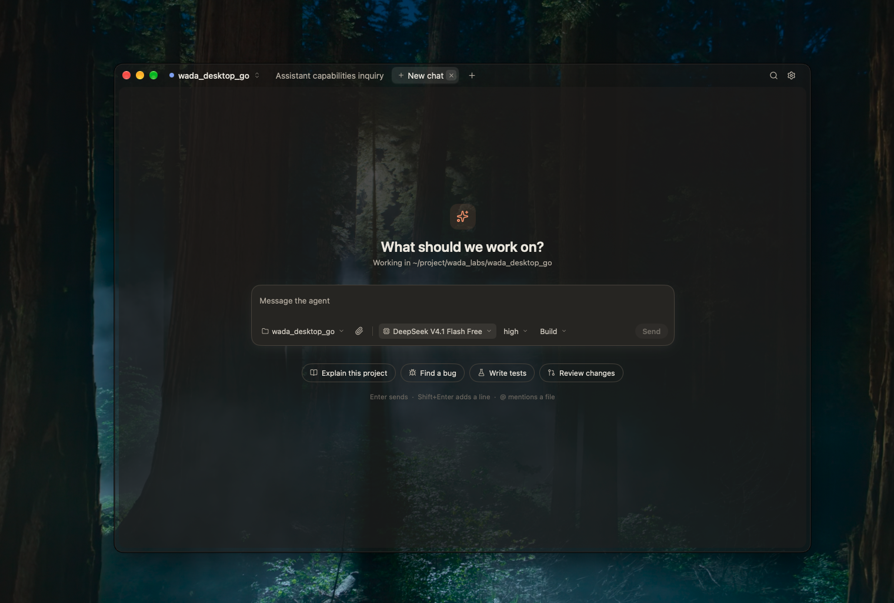
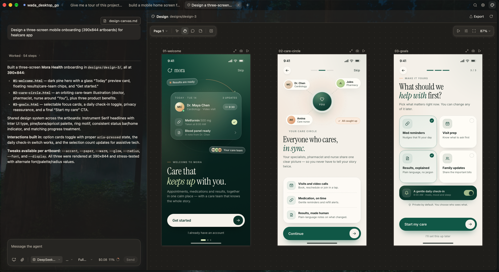

# Wada Cowork

A native desktop assistant for everyday work: understand documents, organize
information, draft reports and correspondence, compare data, plan work and create
useful deliverables. Choose a work folder and say what outcome you need. For
larger tasks, Jobs reads the relevant documents, proposes a plan for approval,
does the work and has an independent agent review the result. Built with Go, MyGo and Onevra; PiG
runs the agents inside the app, so no separate agent executable is required.
Chat and controls are native, and the design canvas uses embedded WebViews to
preview local HTML.



Wada is development software. macOS is the tested platform. Windows compilation
is checked in CI, but interactive Windows behavior has not been verified. There
is no signed, notarized public binary release yet; build from source below.

## Run

Install the Go version in [go.mod](go.mod), Python 3 for repository checks, and
Apple's Command Line Tools (`xcode-select --install`) on macOS. The first run needs
network access to download Go modules and MyGo's native libraries.

```sh
git clone https://github.com/xleotranx/wada_desktop_go.git
cd wada_desktop_go
go mod download
go tool mygo dev .       # live reload; q + Enter quits, r rebuilds
```

`go run .` also runs the app. Connect your own provider in **Settings → Providers**
using an API key or supported browser sign-in. Tests use fake providers and need
no API credentials. Provider usage is subject to that provider's pricing and terms.

To build an app and disk image locally:

```sh
make package            # checks notices; output under build/; ad-hoc signing
```

A distributable macOS binary needs the maintainer's signing and notarization
configuration. Source publication does not supply those credentials.

The public [wada-kit](https://github.com/xleotranx/wada-kit) module is pinned in
`go.mod` and downloaded through normal Go module resolution. It needs no GitHub
credentials, deploy key, or `GOPRIVATE` configuration.

For local kit work and version upgrades, see
[kit dependency maintenance](docs/design/kit-dependency.md).

## Features

**Jobs** — the app's front door. Type what you want on the Jobs page (⌘J), pick
the folder, and **Start job**: the app converts the folder's Word, PowerPoint,
Excel, OpenDocument, RTF, EPUB, CSV and PDF files to Markdown in-process (anydoc
compiled to WebAssembly — no service, no upload), the agent returns a plan you
can edit, step by step, before anything runs. The work turn writes the file the
plan names; a reviewer with read-only tools judges it against the plan's
criteria and either passes it or sends one round of defects back. The result, the
reviewer's findings and the deliverables are on the page, in `jobs.db`, and in
your folder. A plan that is ready or a job that settled raises a desktop notice
that opens straight to it.

Chat with streaming markdown, tool calls, approvals and stop; open chats and Settings as tabs across the title strip, one folder's space at a time with a
switcher for the others, each tab showing whether its conversation is working, waiting for you or unread; All
chats (⌘K) to find any chat the app started (its own record, in SQLite), folder or
command; folders picked with ⌘O, All chats or the composer; a work panel beside a
conversation with its context, session or uncommitted Git changes with expandable diffs, and cost;
model, effort and mode pickers; file and image attachments; workflows such as plan,
work, review in the current chat; desktop notifications for conversations in the background; settings
for appearance, tabs, PiG, providers, notifications, and turning plugins
on and off.

Select text in a conversation for **Start a side chat** or **Reply**. A side chat
opens in a drawer beside the conversation with the selection quoted in its own
composer; it can read files but not change them, and **Add to main chat** puts an
answer in the original chat's draft.

For visual instructions, paste or attach a screenshot and choose **Mark up**
beside its image chip. Draw arrows or boxes, add an optional instruction, then
choose **Use annotated image**. The marked PNG goes with your next message;
the source file stays unchanged. Images are limited to 16 megapixels and 16,384
pixels per side, in addition to the attachment byte limits.

Ordinary chats use work-folder tools: list files, read and search documents, write
or revise text deliverables, verify arithmetic and read a known source URL. Office
and PDF reading uses the embedded document reader. Shell commands and unrestricted
coding tools are unavailable. Wada does not automatically load repository agent
instructions; skills are included when explicitly selected. Without a selected
folder, new conversations use a dedicated Inbox rather than the user's home folder.

The composer offers **Ask before changes** (the default) and **Work independently**.
Ask mode permits reads and searches, and asks before edits or web-page requests.
Independent mode performs those operations within the selected work folder.
Workflow planning and review deny edits in either mode; reviewer
children retain their fixed policies. Questions do not restart the workflow, while
related changes receive another independent review. Queued follow-ups are handled
after the active turn. Tasks and queues persist in `workflow.db`; interrupted work
requires explicit resume.

**Design canvas** — work with the agent beside previews of its HTML artboards.



## Architecture

| Package | Responsibility |
| --- | --- |
| `github.com/xleotranx/wada-kit` | Independently released kit: kernel, window shell, palette, settings page and plugin diagnostics ([repository](https://github.com/xleotranx/wada-kit)) |
| `main.go` | Wada's name, window and menus, and the plugins this build installs |
| `internal/contract/*` | Declarations Wada's plugins share: `agent`, `chat`, `tabs`, `workspace`, `workflow` |
| `internal/plugins/cowork` | Everyday-work instructions, folder-contained document tools, arithmetic and URL reading |
| `internal/plugins/pig` | Embedded PiG SDK, assistant sessions, permissions and providers |
| `internal/plugins/chat` | Conversation page: transcript, composer, approvals |
| `internal/plugins/models` | Model and effort pickers in the composer |
| `internal/plugins/modes` | Access mode and one-task workflow selection |
| `internal/plugins/usage` | Context and cost, in the work panel or the composer |
| `internal/plugins/filechanges` | Session or local uncommitted Git changes and expandable diffs below Context |
| `internal/plugins/attachments` | Files and images sent with a message |
| `internal/plugins/markup` | Arrows and boxes drawn on pending screenshots, exported as PNG attachments |
| `internal/plugins/workspace` | Folders and the conversations started here, in `workspace.db` |
| `internal/plugins/folderpicker` | Open Folder and the new conversation's folder picker |
| `internal/plugins/tabs` | Tabs across the title strip, one folder's space at a time; the switcher and menus |
| `internal/plugins/explore` | Read-only side chats in a drawer, started from selected text, with answers added to the original draft |
| `internal/plugins/palette` | All chats (⌘K): conversations, folders and commands |
| `internal/plugins/workflow` | Runs conversational tasks with fresh reviewer children |
| `internal/plugins/flows` | The app's flows, such as plan, code, review |
| `internal/plugins/notifications` | Desktop notices for conversations in the background |

Design notes: [kernel API](https://github.com/xleotranx/wada-kit/blob/v0.2.0/docs/kernel-api.md), [kit shell](https://github.com/xleotranx/wada-kit/blob/v0.2.0/docs/shell.md),
[agent contract](docs/design/agent-contract.md),
[shell and built-in plugins](docs/design/shell-and-plugins.md).

## Extend

Write a type that implements `kernel.Plugin`, register what it adds in `Setup`, and
list its factory in `main.go` (`notes.New`); the kernel makes a new one for each
activation:

```go
type Notes struct{ host shell.Host }

func New() kernel.Plugin { return &Notes{} }

func (*Notes) Manifest() kernel.Manifest {
	return kernel.Manifest{ID: "notes", Title: "Notes", Requires: []kernel.Named{shell.HostKey}}
}

func (n *Notes) Setup(c *kernel.Context) error {
	n.host = kernel.Require(c, shell.HostKey)
	kernel.Contribute(c, shell.Pages, "notes.page", 50, shell.Page{Render: renderNotes})
	kernel.Contribute(c, kernel.Commands, "notes.open", 0, kernel.Command{
		Title: "Open Notes", Menu: "View", Keys: []string{"cmd+shift+n"},
		Run: func() { n.host.ShowPage("notes.page") }})
	return nil // a registration that failed fails the Setup by itself
}
```

A new backend is a plugin that provides `agent.ServiceKey` (see the agent contract);
PiG is the only backend installed by this app.

## Local data and permissions

Production settings and app records live under
`~/Library/Application Support/wada-desktop-go/`; `go run` and `mygo dev` use
`wada-desktop-go-dev/`. Set `WADA_DATA_DIR` to choose another directory.

- `settings.db`: settings; `workspace.db`: folder and conversation records;
  `workflow.db`: tasks and queued inputs.
- `pig/sessions/`: conversation transcripts; `pig/metadata/`: app session metadata;
  `pig/agent/`: provider credentials and configuration.

Treat these directories as sensitive. Messages, attachments and tool results sent
to a model go to your chosen provider. Do not include credentials or private
conversation content in issues or screenshots. **Ask before changes** is a tool
permission policy, not an operating-system sandbox. See [SECURITY.md](SECURITY.md).

For experiments and captures, isolate the app's data:

```sh
WADA_DATA_DIR="$(mktemp -d)" WADA_CAPTURE=/tmp/wada.png go run .
```

Database schemas are currently version 1. Unsupported schemas are refused rather
than migrated; back up your data before testing a different build.

## Verify and contribute

```sh
GOWORK=off make check   # lifetime vet, lint, notices, race and no-cgo tests
GOWORK=off go build ./...
make audit             # known Go vulnerabilities
make secrets           # committed source history
```

Tests run plugins in `kerneltest` harnesses with fakes from `internal/plugintest`,
the kit's `kittest`, and native views with `ui.NewTester`. `make demo` starts the
app with synthetic, throwaway data. See [CONTRIBUTING.md](CONTRIBUTING.md) for
setup, focused changes and packaging, and [CHANGELOG.md](CHANGELOG.md) for scope.

## License

Wada is [MIT licensed](LICENSE). Dependencies retain their own licenses. The
[third-party inventory and full notices](resources/licenses/README.md) ship in
packaged builds; run `make licenses` after changing dependencies.
