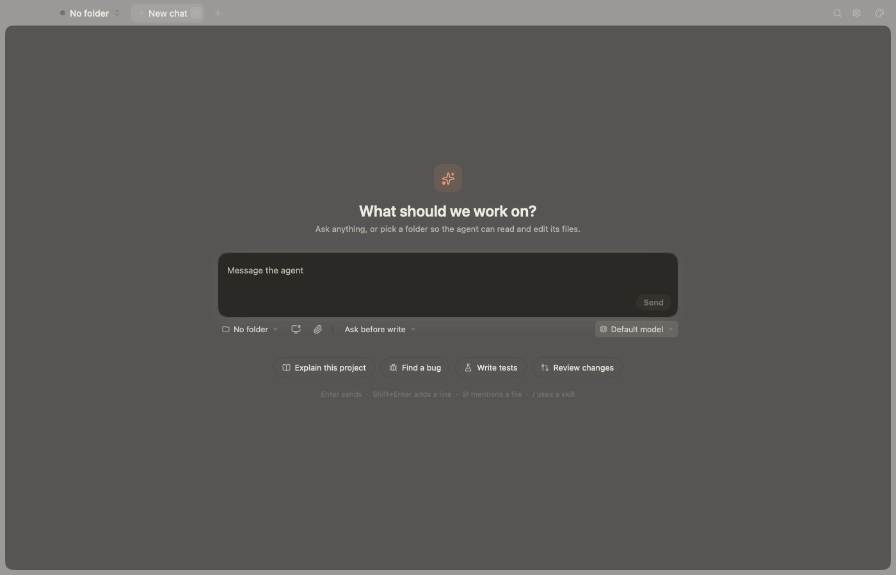

# Wada

An experimental native desktop AI chat and coding app, built with Go, MyGo and
Onevra. PiG runs the coding agent inside the app; no separate agent executable is
required. Chat and controls are native. The design canvas uses embedded WebViews
to preview local HTML.



Wada is development software. macOS is the tested platform. Windows compilation
is checked in CI, but interactive Windows behavior has not been verified. There
is no signed, notarized public binary release yet; build from source below.

## Run

Install the Go version in [go.mod](go.mod), Python 3 for repository checks, and
Apple's Command Line Tools (`xcode-select --install`) on macOS. The first run needs
network access to download Go modules and MyGo's native libraries.

```sh
git clone https://github.com/xleotranx/wada_desktop_go.git
cd wada_desktop_go
go mod download
go tool mygo dev .       # live reload; q + Enter quits, r rebuilds
```

`go run .` also runs the app. Connect your own provider in **Settings → Providers**
using an API key or supported browser sign-in. Tests use fake providers and need
no API credentials. Provider usage is subject to that provider's pricing and terms.

To build an app and disk image locally:

```sh
make package            # checks notices; output under build/; ad-hoc signing
```

A distributable macOS binary needs the maintainer's signing and notarization
configuration. Source publication does not supply those credentials.

The public [wada-kit](https://github.com/xleotranx/wada-kit) module is pinned in
`go.mod` and downloaded through normal Go module resolution. It needs no GitHub
credentials, deploy key, or `GOPRIVATE` configuration.

For local kit work and version upgrades, see
[kit dependency maintenance](docs/design/kit-dependency.md).

## Features

Chat with streaming markdown, tool calls, approvals and stop; open chats and Settings as tabs across the title strip, one folder's space at a time with a
switcher for the others, each tab showing whether its conversation is working, waiting for you or unread; All
chats (⌘K) to find any chat the app started (its own record, in SQLite), folder or
command; folders picked with ⌘O, All chats or the composer; a work panel beside a
conversation with its context, session or uncommitted Git changes with expandable diffs, and cost;
model, effort and mode pickers; file and image attachments; workflows such as plan,
code, review in the current chat; desktop notifications for conversations in the background; settings
for appearance, tabs, PiG, providers, notifications, and turning plugins
on and off.

Select text in a conversation for **Start a side chat** or **Reply**. A side chat
opens in a drawer beside the conversation with the selection quoted in its own
composer; it can read files but not change them, and **Add to main chat** puts an
answer in the original chat's draft.

For visual instructions, paste or attach a screenshot and choose **Mark up**
beside its image chip. Draw arrows or boxes, add an optional instruction, then
choose **Use annotated image**. The marked PNG goes with your next message;
the source file stays unchanged. Images are limited to 16 megapixels and 16,384
pixels per side, in addition to the attachment byte limits.

The composer offers **Ask before write** (the default) and **Full access**. Ask mode
allows reads and searches and asks before edits, shell commands, web access and
unknown tools. Workflow planning and review deny edits even in Full access; reviewer
children retain their fixed policies. Questions do not restart the workflow, while
related changes receive another independent review. Queued follow-ups are handled
after the active turn. Tasks and queues persist in `workflow.db`; interrupted work
requires explicit resume.

## Architecture

| Package | Responsibility |
| --- | --- |
| `github.com/xleotranx/wada-kit` | Independently released kit: kernel, window shell, palette, settings page and plugin diagnostics ([repository](https://github.com/xleotranx/wada-kit)) |
| `main.go` | Wada's name, window and menus, and the plugins this build installs |
| `internal/contract/*` | Declarations Wada's plugins share: `agent`, `chat`, `tabs`, `workspace`, `workflow` |
| `internal/plugins/pig` | Embedded PiG SDK, sessions, permissions, providers and coding tools |
| `internal/plugins/chat` | Conversation page: transcript, composer, approvals |
| `internal/plugins/models` | Model and effort pickers in the composer |
| `internal/plugins/modes` | Access mode and one-task workflow selection |
| `internal/plugins/usage` | Context and cost, in the work panel or the composer |
| `internal/plugins/filechanges` | Session or local uncommitted Git changes and expandable diffs below Context |
| `internal/plugins/attachments` | Files and images sent with a message |
| `internal/plugins/markup` | Arrows and boxes drawn on pending screenshots, exported as PNG attachments |
| `internal/plugins/workspace` | Folders and the conversations started here, in `workspace.db` |
| `internal/plugins/folderpicker` | Open Folder and the new conversation's folder picker |
| `internal/plugins/tabs` | Tabs across the title strip, one folder's space at a time; the switcher and menus |
| `internal/plugins/explore` | Read-only side chats in a drawer, started from selected text, with answers added to the original draft |
| `internal/plugins/palette` | All chats (⌘K): conversations, folders and commands |
| `internal/plugins/workflow` | Runs conversational tasks with fresh reviewer children |
| `internal/plugins/flows` | The app's flows, such as plan, code, review |
| `internal/plugins/notifications` | Desktop notices for conversations in the background |

Design notes: [kernel API](https://github.com/xleotranx/wada-kit/blob/v0.1.1/docs/kernel-api.md), [kit shell](https://github.com/xleotranx/wada-kit/blob/v0.1.1/docs/shell.md),
[agent contract](docs/design/agent-contract.md),
[shell and built-in plugins](docs/design/shell-and-plugins.md).

## Extend

Write a type that implements `kernel.Plugin`, register what it adds in `Setup`, and
list its factory in `main.go` (`notes.New`); the kernel makes a new one for each
activation:

```go
type Notes struct{ host shell.Host }

func New() kernel.Plugin { return &Notes{} }

func (*Notes) Manifest() kernel.Manifest {
	return kernel.Manifest{ID: "notes", Title: "Notes", Requires: []kernel.Named{shell.HostKey}}
}

func (n *Notes) Setup(c *kernel.Context) error {
	n.host = kernel.Require(c, shell.HostKey)
	kernel.Contribute(c, shell.Pages, "notes.page", 50, shell.Page{Render: renderNotes})
	kernel.Contribute(c, kernel.Commands, "notes.open", 0, kernel.Command{
		Title: "Open Notes", Menu: "View", Keys: []string{"cmd+shift+n"},
		Run: func() { n.host.ShowPage("notes.page") }})
	return nil // a registration that failed fails the Setup by itself
}
```

A new backend is a plugin that provides `agent.ServiceKey` (see the agent contract);
PiG is the only backend installed by this app.

## Local data and permissions

Production settings and app records live under
`~/Library/Application Support/wada-desktop-go/`; `go run` and `mygo dev` use
`wada-desktop-go-dev/`. Set `WADA_DATA_DIR` to choose another directory.

- `settings.db`: settings; `workspace.db`: folder and conversation records;
  `workflow.db`: tasks and queued inputs.
- `pig/sessions/`: conversation transcripts; `pig/metadata/`: app session metadata;
  `pig/agent/`: provider credentials and configuration.

Treat these directories as sensitive. Messages, attachments and tool results sent
to a model go to your chosen provider. Do not include credentials or private
conversation content in issues or screenshots. **Ask before write** is a tool
permission policy, not an operating-system sandbox. See [SECURITY.md](SECURITY.md).

For experiments and captures, isolate the app's data:

```sh
WADA_DATA_DIR="$(mktemp -d)" WADA_CAPTURE=/tmp/wada.png go run .
```

Database schemas are currently version 1. Unsupported schemas are refused rather
than migrated; back up your data before testing a different build.

## Verify and contribute

```sh
GOWORK=off make check   # lifetime vet, lint, notices, race and no-cgo tests
GOWORK=off go build ./...
make audit             # known Go vulnerabilities
make secrets           # committed source history
```

Tests run plugins in `kerneltest` harnesses with fakes from `internal/plugintest`,
the kit's `kittest`, and native views with `ui.NewTester`. `make demo` starts the
app with synthetic, throwaway data. See [CONTRIBUTING.md](CONTRIBUTING.md) for
setup, focused changes and packaging, and [CHANGELOG.md](CHANGELOG.md) for scope.

## License

Wada is [MIT licensed](LICENSE). Dependencies retain their own licenses. The
[third-party inventory and full notices](resources/licenses/README.md) ship in
packaged builds; run `make licenses` after changing dependencies.
