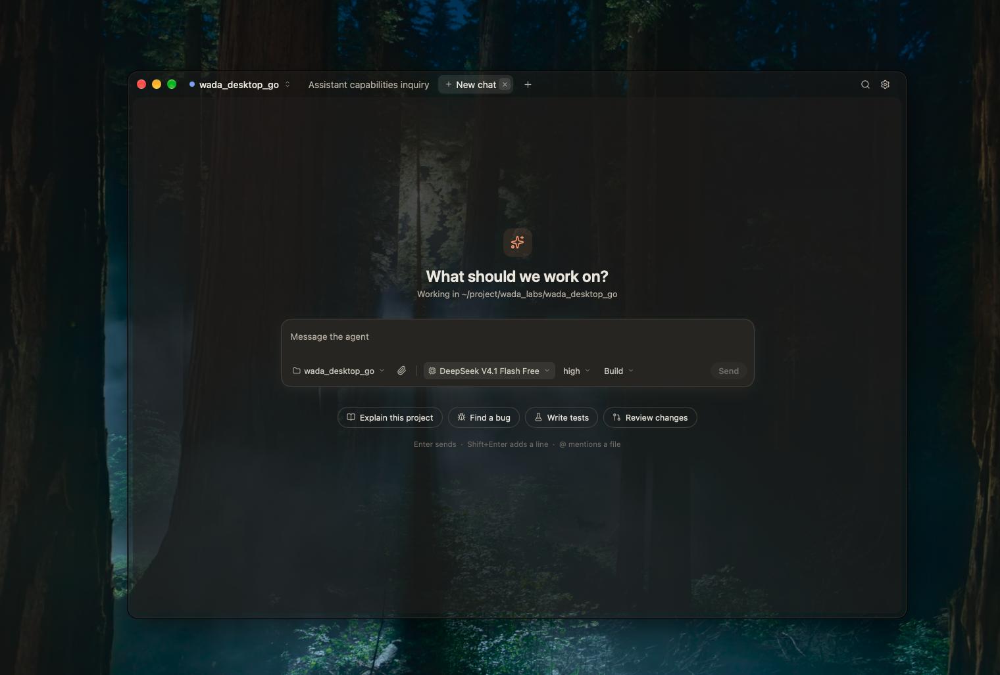

# Wada

A native desktop coding-agent workspace: explore codebases, edit files, run commands, and inspect diffs beside the conversation. Built with Go, MyGo and Onevra; the headless `wadad` daemon embeds PiG so coding turns keep running even when the desktop window closes.
Chat and controls are native.



Wada is development software. macOS is the tested desktop platform. The repository
also includes a Windows cross-build check. Use the source build below for desktop
development.

## Run

Install the Go version in [go.mod](go.mod), Python 3 for repository checks, and
Apple's Command Line Tools (`xcode-select --install`) on macOS. The first run needs
network access to download Go modules and MyGo's native libraries.

```sh
git clone https://github.com/xleotranx/wada_desktop_go.git
cd wada_desktop_go
go mod download
go tool mygo dev .       # live reload; q + Enter quits, r rebuilds
```

`go run .` also runs the app. Connect your own provider in **Settings → Providers**
using an API key or supported browser sign-in. Tests use fake providers and need
no API credentials. Provider usage is subject to that provider's pricing and terms.

To build an app and disk image locally:

```sh
make package            # checks notices; output under build/; ad-hoc signing
```

A distributable macOS binary needs the maintainer's signing and notarization
configuration. This repository does not supply those credentials.

The public [wada-kit](https://github.com/xleotranx/wada-kit) module is pinned in
`go.mod` and downloaded through normal Go module resolution. It needs no GitHub
credentials, deploy key, or `GOPRIVATE` configuration.

For local kit work and version upgrades, see
[kit dependency maintenance](docs/design/kit-dependency.md).

## Use Wada

- [Workspace guide](docs/workspaces.md) — register projects, isolate tasks in Git
  worktrees, edit files, run services, review changes, and archive or restore work.
- [Remote access and self-hosting](docs/self-hosting.md) — direct connections, SSH,
  encrypted relay pairing, the web app, and Docker.
- [Security and permissions](SECURITY.md) — provider access, local data, and tool
  approvals.

Chats stream model output and tool calls, with approvals, image attachments,
screenshot markup, file mentions, and skill completions. Open **All chats** (⌘K)
to find conversations in active workspaces, projects, and commands. Select
transcript text to reply or start a read-only side chat. **Add to main chat**
copies its answer into the original draft. On desktop, **Dictate** (⇧⌘M)
uses the embedded browser's speech recognition when available.

The daemon embeds PiG and can also run Claude Code, Codex, and ACP harnesses.
Agent profiles save launch settings, and schedules and heartbeats run on the
daemon while the desktop is closed.

## Architecture

Desktop is composed in `main.go` from plugins under `internal/plugins`, with
shared contracts in `internal/contract`. The
[wada-kit](https://github.com/xleotranx/wada-kit) module supplies the kernel, shell,
palette, and settings host.

Desktop, the `wada` CLI, and the React web app use the `wadad` daemon's WebSocket
RPC. The daemon owns agents, workspaces, worktrees, and schedules. The
`wadad-term` worker hosts PTY terminals independently of the daemon, and
`wada-relay` forwards encrypted connections for remote clients.

- [Agent contract and RPCs](docs/design/agent-contract.md)
- [Desktop shell and plugins](docs/design/shell-and-plugins.md)
- [Kit dependency maintenance](docs/design/kit-dependency.md)
- [Performance and measurement](docs/performance.md)

## Extend

Write a type that implements `kernel.Plugin`, register what it adds in `Setup`, and
list its factory in `main.go` (`notes.New`); the kernel makes a new one for each
activation:

```go
type Notes struct{ host shell.Host }

func New() kernel.Plugin { return &Notes{} }

func (*Notes) Manifest() kernel.Manifest {
	return kernel.Manifest{ID: "notes", Title: "Notes", Requires: []kernel.Named{shell.HostKey}}
}

func (n *Notes) Setup(c *kernel.Context) error {
	n.host = kernel.Require(c, shell.HostKey)
	kernel.Contribute(c, shell.Pages, "notes.page", 50, shell.Page{Render: renderNotes})
	kernel.Contribute(c, kernel.Commands, "notes.open", 0, kernel.Command{
		Title: "Open Notes", Menu: "View", Keys: []string{"cmd+shift+n"},
		Run: func() { n.host.ShowPage("notes.page") }})
	return nil // a registration that failed fails the Setup by itself
}
```

A new backend is a plugin that provides `agent.ServiceKey` (see the agent contract);
the `daemon` plugin is the built-in backend installed by this app, talking to `wadad` (embedded PiG plus supervised CLI harnesses).

## Local data and permissions

Production settings and app records live under
`~/Library/Application Support/wada-desktop-go/`; `go run` and `mygo dev` use
`wada-desktop-go-dev/`. Set `WADA_DATA_DIR` to choose another directory.

- `settings.db`: settings;
  `wadad.db`: daemon identity, idempotency receipts, sequenced event timelines, and projects and workspaces.
- `wadad.pid`, `wadad.lock`, `local-credential`, `wadad.log`: local daemon discovery, lock, and authentication files.
- `daemon-keypair.json`, `remote-token`, `password.hash`, `hosts.json`: E2EE relay identity keys, optional remote password hash, and saved remote host profiles.
- `worktrees/`: the default location for new Git worktrees. Use `wadad --worktree-dir /absolute/path` or set `WADA_WORKTREE_DIR` in the daemon's environment to place new worktrees elsewhere on the host. Restored workspaces use their recorded locations.
- `terminal-worker/`: detached PTY worker IPC descriptors.
- `pig/sessions/`: conversation transcripts; `pig/metadata/`: app session metadata;
  `pig/baselines/`: lazy on-disk session diff baselines; `pig/agent/`: provider credentials and configuration.

New worktree branches use the `wada/` prefix by default. Set `wadad --branch-prefix`
or `WADA_BRANCH_PREFIX` to change it, or use an empty value to omit it.

Treat these directories as sensitive. Messages, attachments and tool results sent
to a model go to your chosen provider. Do not include credentials or private
conversation content in issues or screenshots. **Ask before changes** is a tool
permission policy, not an operating-system sandbox. See [SECURITY.md](SECURITY.md).

For experiments and captures, isolate the app's data:

```sh
WADA_DATA_DIR="$(mktemp -d)" WADA_CAPTURE=/tmp/wada.png go run .
```

`settings.db` uses schema 1. `wadad.db` uses schema 6, applies numbered migrations
to older databases, and refuses newer schemas. Back up the data directory before
testing a different build.

## Verify and contribute

```sh
GOWORK=off make check   # lifetime vet, lint, notices, race and no-cgo tests
GOWORK=off go build ./...
make audit             # known Go vulnerabilities
make secrets           # committed source history
make web-test          # web client tests and TypeScript typecheck
make web-build         # web client production bundle
```

Tests run plugins in `kerneltest` harnesses with fakes from `internal/plugintest`,
the kit's `kittest`, and native views with `ui.NewTester`. `make demo` starts the
app with synthetic, throwaway data. See [CONTRIBUTING.md](CONTRIBUTING.md) for
setup, focused changes and packaging, and [CHANGELOG.md](CHANGELOG.md) for scope.

## License

Wada is [MIT licensed](LICENSE). Dependencies retain their own licenses. The
[third-party inventory and full notices](resources/licenses/README.md) ship in
packaged builds; run `make licenses` after changing dependencies.
